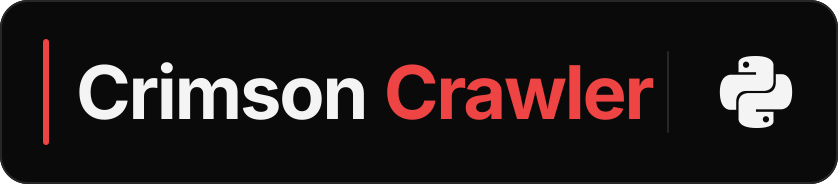

# Crimson Crawler Python SDK

<p align="center">
  <a href="https://crimsoncrawler.com">
    
  </a>
</p>
<p align="center">
  <a href="https://crimsoncrawler.com">
    
  </a>
</p>
<p align="center"><strong>Typed, async threat intelligence for Python.</strong></p>
<p align="center">
  <a href="https://crimsoncrawler.com/docs/clients/python-client/">Documentation</a> ·
  <a href="https://pypi.org/project/crimson-crawler-client/">PyPI</a> ·
  <a href="https://github.com/crimson-crawler/python-sdk">GitHub</a> ·
  <a href="https://crimsoncrawler.com/dashboard">Get an API key</a>
</p>
<p align="center">
  <a href="https://pypi.org/project/crimson-crawler-client/"></a>
  
  
  <a href="LICENSE"></a>
</p>

Turn a CVE into a complete, typed attack briefing with one async call. The client also covers package, IOC, CWE, and ATT&CK enrichment, artifact and inventory workflows, grounded reports, and every v1 endpoint without hand-written request models.

## Install

```bash
pip install crimson-crawler-client
# or
uv add crimson-crawler-client
```

Python 3.11+.

Published on [PyPI](https://pypi.org/project/crimson-crawler-client/); the commands above install the latest release.

## Authentication

Set your key in the environment:

```bash
export CRIMSON_CRAWLER_API_KEY=your-api-key
```

Or pass it directly (preferred for tests and multi-tenant code):

```python
async with CrawlerClient(api_key="your-api-key") as client:
    ...
```

The constructor argument wins over the env var. Generate a key at [crimsoncrawler.com/dashboard](https://crimsoncrawler.com/dashboard).

## Custom or local endpoint

The hosted API at `https://crimsoncrawler.com` is the default. Point the
official package at a local or self-hosted deployment with either form:

```bash
export CRIMSON_CRAWLER_BASE_URL=http://localhost:8000
```

```python
client = CrawlerClient(base_url="http://localhost:8000")
```

The SDK sends its `apikey` header to the selected origin. Use a local or
development key when overriding the endpoint; do not reuse a production key
with an origin you do not control. Custom non-loopback endpoints must use
HTTPS. Plain HTTP is accepted only for loopback development URLs such as the
example above. TLS verification stays enabled by default; trust the
deployment's CA when possible. `verify_ssl=False` or
`CRIMSON_CRAWLER_VERIFY_SSL=false` is only for isolated local development with
a self-signed certificate. The SDK emits a warning for either override.

## Quick start

```python
import asyncio
from crimson_crawler_client import CrawlerClient


async def main() -> None:
    async with CrawlerClient() as client:
        result = await client.enrich_cve_full("CVE-2024-3400")

        if result.cve:
            print(result.cve.cvss_v3_score, result.cve.cvss_v4_score)

        for technique in result.techniques or []:
            print(technique.technique_id, technique.name)


asyncio.run(main())
```

Every list-valued field on an enrichment response can be `None` if that layer wasn't requested or had no data. The `or []` guard is the standard pattern.

OSV advisories may span pages. Use `iter_cve_osv_pages(cve_id)` or
`iter_vulnerability_exposure_osv_pages(cve_ids)` to stream them without collecting the full walk.
Pass an explicit `include` containing `osv_restricted` for restricted or unknown-licence records.
An expired snapshot raises `UnexpectedStatus`; restart the walk rather than appending a new
snapshot to pages already consumed.

## The client

### Constructor

```python
CrawlerClient(
    api_key: str | None = None,
    base_url: str | None = None,
    verify_ssl: bool | None = None,
    max_retries: int = 2,
)
```

| Parameter | Type | Default | Description |
|---|---|---|---|
| `api_key` | `str \| None` | env `CRIMSON_CRAWLER_API_KEY` | Sent as the `apikey` header on every request. |
| `base_url` | `str \| None` | env `CRIMSON_CRAWLER_BASE_URL`, then `https://crimsoncrawler.com` | Custom, self-hosted, or local API origin. |
| `verify_ssl` | `bool \| None` | env `CRIMSON_CRAWLER_VERIFY_SSL`, then `True` | Disable only for isolated local development; prefer trusting the deployment CA. |
| `max_retries` | `int` | `2` | Number of automatic retries on transient failures (see [Retry & rate limits](#retry--rate-limits)). `0` disables. |

Raises `MissingCredentials` if neither `api_key` nor the env var is set. Raises `ValueError` for a malformed or insecure non-loopback `base_url`, or if `max_retries < 0`.

### Properties

- **`api`** — pass this to any endpoint function when calling endpoints directly (see [Beyond the convenience surface](#beyond-the-convenience-surface)).
- **`base_url`** — read-only; the resolved hosted, custom, or local endpoint.
- **`max_retries`** — read-only; the configured retry budget (see [Retry & rate limits](#retry--rate-limits)).

### Async lifecycle

`CrawlerClient` is an async context manager. The recommended pattern:

```python
async with CrawlerClient() as client:
    result = await client.enrich_cve_full("CVE-2024-3400")
```

Entering opens the HTTP client. Exiting closes it.

If you need finer control:

```python
client = CrawlerClient()
try:
    result = await client.enrich_cve_full("CVE-2024-3400")
finally:
    await client.aclose()
```

A single `CrawlerClient` can issue many concurrent requests. TCP connections are reused across calls, so don't construct one per request.

## Convenience methods

**Every `/v1` operation has a method** — 38 of them, plus the `search_techniques` shortcut. The seven documented in full below cover the highest-traffic patterns; the rest are grouped after them with their signatures. The 17 `enrich_*_full` methods call their endpoint with a full-walk `include=[...]` preset baked in (pass `include=` to override); the others take no preset. Every method is `async`, returns a typed response model, and raises `UnexpectedStatus` on a non-2xx.

| Group | Methods |
|---|---|
| Full-walk enrichment (17) | `enrich_cve_full` · `enrich_ioc_full` · `enrich_cwe_full` · `enrich_technique_full` · `enrich_product_full` · `enrich_package_full` · `enrich_capec_full` · `enrich_group_full` · `enrich_software_full` · `enrich_campaign_full` · `enrich_atlas_full` · `enrich_disarm_full` · `enrich_defend_full` · `enrich_f3_full` · `enrich_cloak_full` · `enrich_location_full` · `enrich_sector_full` |
| Enrichment, no preset (2) | `enrich_batch` · `enrich_poc_source` |
| Search (9 + 1) | `search_cve` · `search_cti` · `search_csaf` · `search_kev` · `search_misp` · `search_knowledgebase` · `search_vendor` · `search_poc` · `search_d3fend` · `search_techniques` |
| Assessment (4) | `assess_technique_coverage` · `assess_vulnerability_exposure` · `assess_group_exposure` · `assess_ioc_portfolio` |
| Async engines (6) | `artifact_enrich` · `artifact_enrich_status` · `inventory_enrich` · `inventory_enrich_status` · `event_enrich` · `event_enrich_status` |

#### `enrich_cve_full(cve_id, *, include=None)`

Returns CVE details, EPSS, KEV, weaknesses, attack patterns, ATT&CK techniques, TIE predictions and other default-on source layers. MISP and knowledge-base context require explicit includes.

```python
async with CrawlerClient() as client:
    result = await client.enrich_cve_full("CVE-2024-3400")

    if result.cve:
        print(f"CVSS v{result.cve.cvss_v3_version}: {result.cve.cvss_v3_score} ({result.cve.cvss_v3_severity})")
        print(f"Description: {result.cve.description}")

    if result.epss:
        print(f"EPSS: {result.epss.epss} (percentile {result.epss.percentile})")
    if result.kev and result.kev.in_kev:
        print(f"KEV: added {result.kev.date_added}")

    print(f"Weaknesses: {len(result.weaknesses or [])} CWE(s)")
    print(f"Attack patterns: {len(result.attack_patterns or [])} CAPEC(s)")
    for t in result.techniques or []:
        print(f"  Technique: {t.technique_id} - {t.name}")
    for p in result.predictions or []:
        print(f"  TIE prediction: {p.technique_id} ({p.probability})")
```

| Parameter | Type | Default | Description |
|---|---|---|---|
| `cve_id` | `str` | required | CVE identifier, e.g. `"CVE-2024-3400"`. |
| `include` | `list[str] \| None` | `presets.CVE_FULL_WALK` | Override the default include list. |

Returns: `EnrichCVEResponse`.

#### `enrich_ioc_full(value, ioc_type="ip-dst", *, include=None)`

Returns MISP attribute matches, linked ATT&CK techniques, defensive context, sightings, warninglists and list/network context for an indicator. Request other layers explicitly.

```python
async with CrawlerClient() as client:
    result = await client.enrich_ioc_full("203.0.113.5", "ip-dst")

    for attr in result.misp_attributes or []:
        print(f"MISP event: {attr.event_info}")
    for t in result.techniques or []:
        print(f"Linked technique: {t.technique_id}")
```

| Parameter | Type | Default | Description |
|---|---|---|---|
| `value` | `str` | required | Indicator value. |
| `ioc_type` | `str` | `"ip-dst"` | MISP-style attribute type: `ip-dst`, `ip-src`, `domain`, `hostname`, `md5`, `sha1`, `sha256`, `url`, etc. |
| `include` | `list[str] \| None` | `presets.IOC_FULL_WALK` | Override the default include list. |

Returns: `EnrichIOCResponse`.

#### `enrich_cwe_full(cwe_id, *, include=None)`

Returns the weakness, mapped CAPEC attack patterns, ATT&CK techniques, and TIE predictions. Use it when you start from a weakness ID.

```python
async with CrawlerClient() as client:
    result = await client.enrich_cwe_full("CWE-79")

    if result.weakness:
        print(f"Weakness: {result.weakness.name}")
    print(f"CAPEC patterns: {len(result.attack_patterns or [])}")
    print(f"Techniques: {len(result.techniques or [])}")
```

| Parameter | Type | Default | Description |
|---|---|---|---|
| `cwe_id` | `str` | required | CWE identifier, e.g. `"CWE-79"`. |
| `include` | `list[str] \| None` | `presets.CWE_FULL_WALK` | Override the default include list. |

Returns: `EnrichCWEResponse`.

#### `enrich_technique_full(technique_ids=None, *, framework="enterprise", asset_id=None, include=None)`

Returns technique details, TIE predictions, attributed groups, software, campaigns, and a Navigator JSON layer for one or more ATT&CK techniques.

```python
async with CrawlerClient() as client:
    result = await client.enrich_technique_full(
        ["T1190", "T1059.001"],
        framework="enterprise",
    )

    for t in result.techniques or []:
        print(f"{t.technique_id}: {t.name}")
    for g in result.groups or []:
        print(f"Group using these: {g.name}")
```

| Parameter | Type | Default | Description |
|---|---|---|---|
| `technique_ids` | `list[str]` | optional | ATT&CK technique IDs. Omitted (sent UNSET) when you look up by `asset_id`. |
| `framework` | `str` | `"enterprise"` | ATT&CK matrix variant: `enterprise`, `ics`, or `mobile`. `asset_id` requires `"ics"`. |
| `asset_id` | `str \| None` | `None` | ICS asset id (`^A\\d{4}$`) — looks a technique up FROM an asset instead. Mutually exclusive with `technique_ids` / `technique_id` / `search` (the API answers `422`). The response carries the resolved `asset` plus its real targets in `techniques[]`. |
| `include` | `list[str] \| None` | `presets.TECHNIQUE_FULL` | Override the default include list. |

Returns: `EnrichTechniqueResponse`.

#### `enrich_product_full(product, *, version=None, vendor=None, include=None, limit=2, offset=0, snapshot_id=None)`

Returns a page of enriched CVEs for a product and version.

The product bundle lookup sends the CPE identifier verbatim, so CPE 2.2 URIs and identifiers
containing `/`, `?`, `#`, `%`, or their backslash escapes resolve exactly. A lookup that cannot
reach the source reports service `vulnerability-data` in `errors[]` rather than a confirmed empty
result, and the failure is not cached.

```python
async with CrawlerClient() as client:
    async for page in client.iter_product_cves("http_server", version="2.4.51", vendor="apache"):
        for row in page.cves or []:
            print(row.discovered_cve_id)
```

| Parameter | Type | Default | Description |
|---|---|---|---|
| `product` | `str` | required | Product name, e.g. `"Apache HTTP Server"`, `"nginx"`. |
| `version` | `str \| None` | `None` | Specific version (e.g. `"2.4.51"`). Optional. |
| `vendor` | `str \| None` | `None` | Vendor name to narrow results (e.g. `"apache"`). Optional. |
| `include` | `list[str] \| None` | `presets.PRODUCT_FULL` | Override the default include list. |
| `limit` | `int` | `2` | Maximum CVEs per page, 1–20. The full preset pages smaller than the API default. |
| `offset` | `int` | `0` | Zero-based page offset. |
| `snapshot_id` | `str \| None` | `None` | First page's snapshot ID, required when requesting a later offset. |

Returns: `EnrichProductResponse`.

`cves_discovered` counts the bounded discovery set. `rollups_over` counts the CVEs actually
enriched, up to `cves_enrichment_limit`; `discovery_truncated` and its reason describe whether
discovery was incomplete or its completeness is unknown.
The SDK reconstructs the per-CVE context lists from the response's page-local catalogue.
Keep page 0's product-level sections; later pages contain CVE rows and paging metadata only.
Single-page results need no snapshot. Iterators restart once on an expired snapshot.

#### `enrich_package_full(ecosystem, package, *, version=None, include=None, limit=5, offset=0, snapshot_id=None)`

The package-ecosystem sibling of `enrich_product_full` reads advisories from the stored OSV generation. Default results include permissive sources only; add `osv_restricted` to an explicit include list for restricted and unknown-licence package and nested CVE advisories. This is a breaking change from the prior live query: default results may shrink.

**Breaking OSV licence change:** CVE-linked `osv` returns permissive records only. Requests that previously received restricted or unknown-licence records must add `osv_restricted` to the CVE `include` list alongside any other layers needed. An explicit list replaces the preset. On package enrichment, `osv_restricted` applies to nested CVEs, not the package advisory list. Check source terms before redistribution.

```python
async with CrawlerClient() as client:
    async for page in client.iter_package_advisories("PyPI", "django", version="4.0"):
        for advisory in page.advisories or []:
            print(advisory.id)
```

| Parameter | Type | Default | Description |
|---|---|---|---|
| `ecosystem` | `str` | required | OSV ecosystem, e.g. `"PyPI"`, `"npm"`, `"Go"`, `"Maven"`, `"crates.io"`. |
| `package` | `str` | required | Package name within the ecosystem, e.g. `"django"`. |
| `version` | `str \| None` | `None` | Specific version (e.g. `"4.0"`). Optional. |
| `include` | `list[str] \| None` | `presets.PACKAGE_FULL` | Override the default include list. |
| `limit` | `int` | `5` | Maximum advisories and CVEs per page, 1–20. |
| `offset` | `int` | `0` | Returned `next_offset` for a continuation. |
| `snapshot_id` | `str \| None` | `None` | Page-zero snapshot ID, required for continuation. |

Returns: `EnrichPackageResponse`.

The method returns one page. `iter_package_advisories` streams pages without an aggregate buffer;
if the snapshot expires or changes after a yield, it raises instead of silently restarting.
Follow `next_offset`, not `offset + limit`, because byte limits can shorten a page.

#### `search_techniques(keyword, *, limit=20)`

Keyword-searches the ATT&CK knowledge base and returns matching techniques (attack-patterns).

```python
async with CrawlerClient() as client:
    result = await client.search_techniques("credential dumping", limit=10)

    for hit in result.results or []:
        print(hit)
```

| Parameter | Type | Default | Description |
|---|---|---|---|
| `keyword` | `str` | required | Free-text query, e.g. `"phishing"`, `"credential dumping"`. |
| `limit` | `int` | `20` | Maximum number of results (1-100). |

Returns: `SearchCTIResponse`.

#### The other eleven full-walk enrichments

Same shape as the six above: a full-walk preset baked in, `include=` to override. Each takes an **optional id positional or `search=`** — pass one, not both — so you can go straight to an id or find the entity by name.

```python
async with CrawlerClient() as client:
    apt29 = await client.enrich_group_full("G0016")
    same = await client.enrich_group_full(search="cozy bear")
    ml = await client.enrich_atlas_full("AML.T0043")
```

| Method | Id parameter | Extra keywords | Returns |
|---|---|---|---|
| `enrich_capec_full(capec_id=None, …)` | `CAPEC-66` | `search`, `include` | `EnrichCAPECResponse` |
| `enrich_group_full(group_id=None, …)` | `G0016` | `search`, `framework`, `include`, `limit`, `offset`, `snapshot_id` | `EnrichGroupResponse` |
| `enrich_software_full(software_id=None, …)` | `S0154` | `search`, `framework`, `include` | `EnrichSoftwareResponse` |
| `enrich_campaign_full(campaign_id=None, …)` | `C0028` | `search`, `framework`, `include` | `EnrichCampaignResponse` |
| `enrich_atlas_full(technique_id=None, …)` | `AML.T0043` | `search`, `include` | `EnrichATLASResponse` |
| `enrich_disarm_full(technique_id=None, …)` | `T0001` | `search`, `include` | `EnrichDISARMResponse` |
| `enrich_defend_full(d3fend_id=None, …)` | `D3-AL` | `search`, `include` | `EnrichD3FENDResponse` |
| `enrich_f3_full(f3_id=None, …)` | `F1031` | `search`, `include` | `EnrichF3Response` |
| `enrich_cloak_full(cloak_id=None, …)` | `TTP-496` | `search`, `include` | `EnrichCloakResponse` |
| `enrich_location_full(location_id=None, …)` | `US` | `search`, `include` | `EnrichLocationResponse` |
| `enrich_sector_full(sector_id=None, …)` | `financial-organizations` | `search`, `include` | `EnrichSectorResponse` |

`framework` is `"enterprise"` (default), `"ics"`, or `"mobile"`, and only exists where the endpoint supports a matrix variant.

#### `enrich_batch(items)`

Up to 50 heterogeneous `enrich/*` lookups in **one** request — one call against your rate limit. Items are plain dicts: a `type` discriminator plus that type's fields and its own optional `include`. No preset; the list passes through untouched.

```python
async with CrawlerClient() as client:
    resp = await client.enrich_batch([
        {"type": "cve", "cve_id": "CVE-2024-3400", "include": ["details", "kev"]},
        {"type": "ioc", "value": "1.2.3.4", "value_type": "ip-dst"},
        {"type": "technique", "technique_id": "T1190"},
    ])

    for item in resp.results or []:      # input order preserved
        print(item.index, item.type, item.status)
```

| Parameter | Type | Default | Description |
|---|---|---|---|
| `items` | `list[dict[str, Any]]` | required | 1–50 items. `type` is one of `cve`, `product`, `package`, `cwe`, `capec`, `technique`, `ioc`, `group`, `software`, `campaign`, `atlas`, `disarm`, `location`, `sector`, `defend`, `poc_source`. |

Returns: `EnrichBatchResponse`. One failing item does not fail the batch — each result carries its own `status` and `errors[]`. Two field names to get right: IOC items use **`value_type`** for the indicator type (`type` is taken by the discriminator, unlike `enrich_ioc_full`'s `ioc_type` argument), and the D3FEND discriminator is **`defend`**, matching the endpoint path.

#### `enrich_poc_source(repo_url)`

LLM-summarized analysis of a proof-of-concept exploit repository — what the code does, how weaponized it looks, what it targets. No `include`.

```python
async with CrawlerClient() as client:
    pocs = await client.search_poc("CVE-2024-3400")
    analysis = await client.enrich_poc_source("https://github.com/example/CVE-2024-3400-poc")
```

Returns: `FetchPoCSourceResponse`.

#### Search (9 methods)

One method per search endpoint. `search_cve` defaults to `details`, `statistics`, `cna`, `epss_reports`, and `kb_rankings`; an explicit `include=` replaces the defaults. Rankings keep the first 100 rows per knowledge base without yearly trends; `kb_rankings_total` and `kb_rankings_truncated` describe the reduction, and `kb_rankings_full` restores all fetched rows and trends. `search_misp`, `search_cti`, `search_kev`, and `search_d3fend` also accept `include=`. No search method uses a preset. `search_kev` and `search_misp` take no positional argument.

**5.0.0 migration — MISP event bodies:** `search_misp` returns event summaries by default. Request
`include=["misp_events_full"]` for full event bodies; `objects` also returns full bodies and resolves
object references. An explicit include replaces the defaults (`event_reports`, `tags`, `version`), so
add those values too if needed. Event pages are not snapshots and can shift when MISP data changes.

```python
async with CrawlerClient() as client:
    weaponized = await client.search_cve(kev_only=True, epss_min=0.9, limit=20)
    kev = await client.search_kev(ransomware_status="Known")
    answer = await client.search_knowledgebase("how do I detect kerberoasting", alpha=0.6)
```

| Method | Signature | Returns |
|---|---|---|
| `search_cve` | `(query=None, *, cve_id, stix_id, cwe_id, capec_id, attack_id, cpe, cpes_not_vulnerable, created_by_ref, created_min, created_max, modified_min, modified_max, cvss_min, cvss_v2_min, cvss_v4_min, epss_min, epss_percentile_min, kev_only=False, vuln_status, sort, limit=50, page=1, include)` | `SearchCVEResponse` |
| `search_misp` | `(*, value, type_attribute, category, event_id, eventinfo, tags, date_from, date_to, published, to_ids, threat_level_id, limit=50, page=1, include)` | `SearchMISPResponse` |
| `search_cti` | `(query, *, sources=None, types=None, limit=20, page=1, deprecated=None, revoked=None, include=None)` | `SearchCTIResponse` |
| `search_kev` | `(*, cve_id=None, ransomware_status=None, limit=50, page=1)` | `SearchKEVResponse` |
| `search_knowledgebase` | `(query, *, collections=None, alpha=0.7, limit=10)` | `SearchKnowledgebaseResponse` |
| `search_vendor` | `(vendor=None, *, q=None, limit=50)` | `SearchVendorResponse` — omit `vendor` for the vendor directory, filter with `q` |
| `search_poc` | `(cve_id, *, limit=25)` | `SearchPoCResponse` |
| `search_d3fend` | `(query, *, d3fend_form=None, limit=20, page=1, include=None)` | `SearchD3FENDResponse` |
| `search_csaf` | `(*, cve_id=None, advisory_id=None, publisher=None, sector=None, product=None, cpe=None, tlp=None, sort='newest', limit=20, page=1)` | `SearchCSAFResponse` — CSAF vendor advisories, including CVE-less ones; filters combine with AND |

Constrained values: `vuln_status` is `Received` / `Awaiting Analysis` / `Undergoing Analysis` / `Analyzed` / `Modified` / `Deferred` / `Rejected`; `sort` is `created_ascending` / `created_descending` / `modified_ascending` / `modified_descending` / `epss_score_descending` / `x_opencti_cvss_base_score_descending`; `ransomware_status` is `Known` / `Unknown`; `d3fend_form` is `tactic` / `mitigation` / `sub-mitigation` / `artifact`; `collections` draws from `main` / `large` / `user` / `red_team`; `types` from `attack-pattern` / `intrusion-set` / `malware` / `tool` / `campaign` / `weakness` / `course-of-action`. You pass plain strings — the wrapper converts them.

#### Assessment (4 methods)

Portfolio questions instead of single-entity lookups: what a *set* of techniques, CVEs, actors, or indicators means together. Each takes an optional `include=` passthrough (no preset — omit it and the server default applies); the endpoints cap their inputs at 50.

```python
async with CrawlerClient() as client:
    gaps = await client.assess_technique_coverage(["T1190", "T1059.001", "T1566"])
    exposure = await client.assess_vulnerability_exposure(
        ["CVE-2024-3400", "CVE-2021-44228"],
        stakeholder={"exposure": "controlled", "mission_prevalence": "essential"},
    )
    actors = await client.assess_group_exposure(group_ids=["G0016", "G0007"])
    portfolio = await client.assess_ioc_portfolio([
        {"value": "1.2.3.4", "type": "ip-dst"},
        {"value": "evil.example", "type": "domain"},
    ])
```

| Method | Signature | Returns |
|---|---|---|
| `assess_technique_coverage` | `(technique_ids, *, framework="enterprise", include=None)` | `AssessTechniqueCoverageResponse` |
| `assess_vulnerability_exposure` | `(cve_ids, *, stakeholder=None, include=None)` | `AssessVulnerabilityExposureResponse` |
| `assess_group_exposure` | `(*, group_ids=None, search=None, framework="enterprise", include=None, limit=10, offset=0, snapshot_id=None)` | `AssessGroupExposureResponse` |
| `assess_ioc_portfolio` | `(indicators, *, include=None)` | `AssessIOCPortfolioResponse` |

`stakeholder` is the SSVC decision dict (`method`, `exposure`, `mission_prevalence`, `human_impact`, `public_wellbeing_impact`) and applies when `include` asks for `ssvc`. `assess_group_exposure` takes `group_ids`, free-text `search` terms, or both.

Group and group-exposure calls return one technique page. Use `iter_group_pages` or
`iter_group_exposure_pages` to collect them. The SDK reconstructs log sources from the page
catalogue; `aggregate_over` and `aggregate_total` show tactic coverage, and
`context_techniques_selected` / `context_techniques_limit` disclose bounded context work.

#### Async engines (6 methods)

The raw submit/status pairs behind the three background enrichment engines. A submit returns a job handle immediately (**it counts toward your usage**); the status read is **usage-exempt**, so poll as often as you like. For a one-call version that submits, polls, and hands back the finished report, use [`client.enricher.enrich`](#enricher-clientenricher) / [`client.enricher.enrich_event`](#enricher-clientenricher) or `client.inventory_manager.ingest_scan`.

```python
async with CrawlerClient() as client:
    job = await client.artifact_enrich(text="Suspicious login from 10.1.1.1, then CVE-2024-1234 scan")
    status = await client.artifact_enrich_status(job.enrichment_id)

    inv = await client.inventory_enrich([{"product": "nginx", "version": "1.24.0"}])
    findings = await client.inventory_enrich_status(inv.enrichment_id)

    ev = await client.event_enrich("Suspicious login from 10.1.1.1, then CVE-2024-1234 scan", event_id="INC-2026-0091")
    verdict = await client.event_enrich_status(ev.enrichment_id)
```

| Method | Signature | Returns |
|---|---|---|
| `artifact_enrich` | `(*, text=None, files=None, texts=None, attached_artifact_ids=None, formats=None, stakeholder=None, include=None, tlp=None)` | `EnrichmentSubmitResponse` |
| `artifact_enrich_status` | `(enrichment_id)` | `ArtifactEnrichmentJobResponse` |
| `inventory_enrich` | `(items, *, include=None, attachments_text=None, attachments_texts=None, attachments_files=None, attached_artifact_ids=None, vex_overlay=None)` | `EnrichmentSubmitResponse` |
| `inventory_enrich_status` | `(enrichment_id)` | `InventoryEnrichmentJobResponse` |
| `event_enrich` | `(event, *, event_id=None)` | `EnrichmentSubmitResponse` |
| `event_enrich_status` | `(enrichment_id)` | `EventEnrichmentJobResponse` |

`files` and `attachments_files` are `[{"filename": …, "content_b64": …, "source_artifact_id": …}]`; `texts` / `attachments_texts` are `[{"text": …, "source_artifact_id": …, "filename": …}]` — one row per attached TEXT artifact, so per-artifact provenance survives instead of being flattened into one blob (aggregate caps: 1,000,000 chars for the artifact engine's `text` + `texts[]`, 500,000 for the inventory engine's `attachments_text` + `attachments_texts[]`). `attached_artifact_ids` is the legacy whole-run id list. `items` are asset dicts (`product` is the only required key). `vex_overlay` is an OpenVEX 0.2.0 / CSAF 2.0 VEX document (text) whose `not_affected`/`fixed` statements mark matching findings `suppressed_by_vex` — `inventory_manager.enrich_inventory` sends the inventory's attached overlay for you. `formats` picks the machine exports to build alongside the report (`report`, `json`, `stix`, `vex`, `csaf`, `navigator`, `kev_remediation`, `oscal_poam`, `misp`, `csv`). `event_enrich` takes the raw event text (a Defender XDR / Sentinel alert, a SIEM/EDR log line, any JSON or text, ≤200,000 chars) and an optional caller-side `event_id` (≤200 chars, echoed back on the result); its `event_enrich_status` carries the finished `EventEnrichmentResult` (per-indicator findings + graded aggregate threat assessment). A submit returns `202` with `status: "queued"` plus a `queue_position` when your key already has 3 enrichments running; past 20 in flight it raises `UnexpectedStatus(429)` with `error: "enrichment_queue_full"`.

## Presets

A preset is a named `list[str]`: a curated set of `include` values for one of the common workflows. The point is so you don't have to memorize which `include` values are valid for which endpoint, or pick the right depth for your use case every time.

The `presets` module exports 20 — one full-walk default per enrichment endpoint that accepts `include`, plus three depth variants for the two highest-traffic ones:

| Preset | Use for | Include values |
|---|---|---|
| `CVE_FULL_WALK` | Default for `enrich_cve_full`. Full enrichment depth. | `android_bulletin`, `capec`, `cellular`, `certfr_advisories`, `cisa_campaigns`, `cisa_kev`, `csaf_advisories`, `cvss_bt`, `cwe`, `details`, `detections`, `emb3d`, `epss`, `exploits`, `kev`, `log_sources`, `mitigations`, `nist_controls`, `ot_context`, `poc`, `sigma`, `osv`, `ssvc`, `techniques`, `tie`, `weakness_ranks` |
| `CVE_FAST` | Quick artifact-scan. Score and KEV status, nothing else. | `details`, `epss`, `kev`, `cisa_kev` |
| `CVE_NARRATIVE` | Report generation. Full walk plus AI summary and adversary attribution. | full walk + `summary`, `groups`, `campaigns` |
| `IOC_FULL_WALK` | Default for `enrich_ioc_full`. | `cisa_campaigns`, `defend`, `detections`, `galaxies`, `listed_on`, `log_sources`, `misp_attributes`, `mitigations`, `network_context`, `nist_controls`, `sightings`, `techniques`, `tie`, `warninglist` |
| `IOC_FAST` | Indicator hits in MISP feeds, nothing else. | `misp_attributes` |
| `CWE_FULL_WALK` | Default for `enrich_cwe_full`. | `capecs`, `techniques`, `tie` |
| `TECHNIQUE_FULL` | Default for `enrich_technique_full`. Technique detail and defensive mappings. | `asset_classes`, `atomic_red_team`, `cisa_campaigns`, `defend`, `details`, `detections`, `fight`, `framework_mappings`, `fraud`, `log_sources`, `lolbas`, `lotl`, `mitigations`, `nist_controls`, `sigma`, `tie` |
| `PRODUCT_FULL` | Default for `enrich_product_full`. | Seeded product layers plus `misp` and `knowledgebase`; see `presets.py`. |
| `PACKAGE_FULL` | Default for `enrich_package_full`. OSV advisories + per-CVE full enrichment. | `details`, `severity`, `affected`, `references`, `epss`, `kev`, `cwe`, `capec`, `techniques`, `tie` |
| `CAPEC_FULL` | Default for `enrich_capec_full`. Attack pattern → techniques, CVEs, actors. | `details`, `techniques`, `tie`, `cves`, `groups`, `software`, `campaigns`, `navigator` |
| `GROUP_FULL` | Default for `enrich_group_full`. | Group layers including detections, mitigations and NIST controls; see `presets.py`. |
| `SOFTWARE_FULL` | Default for `enrich_software_full`. Malware / tool → who uses it and how. | `details`, `techniques`, `tie`, `groups`, `campaigns`, `cves`, `navigator` |
| `CAMPAIGN_FULL` | Default for `enrich_campaign_full`. | `details`, `techniques`, `tie`, `groups`, `software`, `cves`, `navigator` |
| `ATLAS_FULL` | Default for `enrich_atlas_full`. Adversarial-ML technique walk. | `details`, `techniques` |
| `DISARM_FULL` | Default for `enrich_disarm_full`. Influence-operation technique. | `details`, `techniques` |
| `F3_FULL` | Default for `enrich_f3_full`. MITRE F3 fraud technique → the ATT&CK techniques it borrows. No adversary graph, so the chain ends at the technique hop. | `details`, `techniques`, `knowledgebase` |
| `CLOAK_FULL` | Default for `enrich_cloak_full`. CLOAK concealment technique — no ATT&CK references, so this set is short by design. | `details`, `knowledgebase` |
| `DEFEND_FULL` | Default for `enrich_defend_full`. D3FEND has no graph hops, so this set is short by design. | `details`, `techniques`, `knowledgebase` |
| `LOCATION_FULL` | Default for `enrich_location_full`. Regional profile walk — the location's own metadata plus knowledge base context. | `details`, `knowledgebase` |
| `SECTOR_FULL` | Default for `enrich_sector_full`. Industry-sector profile walk — the sector's own metadata plus knowledge base context. | `details`, `knowledgebase` |

Every full-walk preset stays inside its endpoint's allowed `include` set (see [Allowed `include` values per endpoint](#allowed-include-values-per-endpoint)) and deliberately leaves out `summary` (LLM generation). `CVE_NARRATIVE` is the one preset that opts into `summary` — that's what it's for.

Presets omit `osv_restricted` and optional layers such as `criteria`, `metasploit`, `nuclei`, `vendor_advisories` and `distro_advisories`. `cisa_kev` is in the CVE and product presets, but not `PACKAGE_FULL`. An explicit `include` replaces the preset.

Three ways to use them:

```python
from crimson_crawler_client import presets

# Pass a preset by name
await client.enrich_cve_full("CVE-2024-3400", include=presets.CVE_NARRATIVE)

# Build on a preset
await client.enrich_cve_full("CVE-2024-3400", include=[*presets.CVE_FAST, "summary"])

# Skip presets entirely and pass your own list
await client.enrich_cve_full("CVE-2024-3400", include=["details", "epss"])
```

Picking one:

- Triaging a list of CVEs? `CVE_FAST`. Sub-second on warm cache.
- Building a report? `CVE_NARRATIVE`. Full enrichment plus an AI summary.
- Recon walk on a single CVE? `CVE_FULL_WALK` (the default).
- Checking if an IP is in MISP? `IOC_FAST`.
- Threat-modeling around a weakness class? `CWE_FULL_WALK`.
- Coverage analysis on specific techniques? `TECHNIQUE_FULL`.
- "What's exposed in this product/version?" `PRODUCT_FULL`.
- Profiling an actor, malware family, or campaign? `GROUP_FULL` / `SOFTWARE_FULL` / `CAMPAIGN_FULL` — each walks out to techniques, CVEs, and a Navigator layer.
- Regional or industry picture? `LOCATION_FULL` / `SECTOR_FULL`.

## Platform

Beyond the `/v1` convenience surface, the client exposes the three key-authed **Platform** sections as dedicated namespaces — Artifact Manager (`client.artifact_manager`), Inventory Manager (`client.inventory_manager`), and Report Generator (`client.ai_reports`). They share your API key and endpoint, return plain dicts, live outside the versioned `/v1` OpenAPI contract, and **never count toward your API usage**. Enrichment is **not** a Platform section: `client.enricher` and `client.inventory_manager.enrich_inventory` submit→poll the `/v1/artifact-enrich` + `/v1/inventory-enrich` + `/v1/event-enrich` engines (the submit always counts toward your usage; the poll is exempt).

### Artifact Manager (`client.artifact_manager`)

`client.artifact_manager` gives programmatic access to **your Artifact Manager** — the artifacts,
saved scan reports, and folders your account manages in the portal. Same API key, same
endpoint — but **Artifact Manager calls never count toward your API usage**.

```python
async with CrawlerClient() as client:
    ws = client.artifact_manager

    # Your saved scans, newest first
    scans = await ws.list_artifacts(kind="artifact_enrichment")

    # Pull a scan's STIX bundle (the body IS the export file)
    formats = await ws.list_exports(scans[0]["id"])      # ["csaf", "csv", "stix", ...]
    stix = await ws.get_export(scans[0]["id"], "stix")   # {"content", "filename", "content_type"}

    # Upload evidence into a folder
    await ws.upload_artifacts(
        [{"name": "ir-notes.txt", "content": "CVE-2024-3400 observed", "format": "paste"}],
        new_folder_name="incident-2026-06",
    )

    # Track change between two enrichments (2–12 ids)
    matrix = await ws.compare_enrichments([old_enrichment_id, new_enrichment_id])
    print(matrix["counts"])  # {"new": 3, "resolved": 1, "changed": 2, "persistent": 14}
```

Full surface: `discovery`, `list_artifacts` (filters incl. `tlp`), `upload_artifacts` (batch `tlp`), `get_artifact`,
`get_artifact_raw` (buffers the raw body as a string, without a JSON re-wrap, up to 10,000,000 bytes),
`update_artifact` (rename / star / move / set `tlp` — a `tlp`-only PATCH is valid), `delete_artifact`, `copy_artifact`, `get_rating` / `set_rating`,
`list_exports` / `get_export`, `download_all_exports` / `download_bundle` / `download_folder` (zip
bundles), `bulk_delete` / `move_to_folder` / `bulk_set_favorite` (bulk ops), `compare_enrichments`,
`save_enrichment`, and folder CRUD (`list_folders`,
`create_folder`, `rename_folder`, `delete_folder`). Responses are plain dicts —
the Artifact Manager surface lives outside the versioned `/v1` OpenAPI contract and evolves
independently. Non-2xx raises the same `UnexpectedStatus`.

Every artifact your library returns carries its own `tlp` — the per-artifact TLP 2.0 marking
(`CLEAR`, `GREEN`, `AMBER`, `AMBER+STRICT`, `RED`); legacy rows read `AMBER`. `list_artifacts(tlp=…)`
filters by it, `upload_artifacts(…, tlp=…)` sets it batch-wide (default `AMBER`), and
`update_artifact(…, tlp=…)` changes it at any time. `get_artifact_raw` also returns it from the
`X-Artifact-Tlp` header. An invalid value raises `ValueError` before any request.

`get_export`, `download_all_exports`, `download_bundle`, and `download_folder` take an optional
`tlp=` — the TLP 2.0 marking stamped into every export format that has a slot for one
(`CLEAR`, `GREEN`, `AMBER`, `AMBER+STRICT`, `RED`), overriding the artifact's stored marking. Omit it
and each export is stamped with the **artifact's own stored `tlp`** (the bundle/folder zips use each
artifact's own). OpenVEX, CSV, and the DISA
eMASS worksheet carry no marking slot and ignore it. An invalid value raises `ValueError` before any
request.

### Inventory Manager (`client.inventory_manager`)

`client.inventory_manager.ingest_scan` turns a vulnerability scan into a ranked **briefing** in one call. It
parses the scan file **server-side** (so the parsers stay in one place), enriches the discovered assets
through the `/v1/inventory-enrich` KEV-first ranking engine, and returns a structured briefing.

```python
async with CrawlerClient() as client:
    with open("scan.xml") as f:
        briefing = await client.inventory_manager.ingest_scan(f.read(), "nmap")

    print(briefing["parsed_count"], "assets")
    for a in briefing["recommended_actions"]:        # KEV-first, top-N
        print(a["cve_id"], a["product"], a["reason"])
    # briefing["report"] is the full /v1/inventory-enrich result (per-asset findings + rollup)
```

`scan_format` is one of `json` / `sbom` / `csv` / `nmap` / `list` / `grype` / `trivy` / `depcheck` / `nessus` / `gvm` / `xlsx` / `vex` (you PICK it — no auto-detection). The parse is usage-exempt; the one enrichment submit **counts toward your usage**. Need just the parsed assets? `client.inventory_manager.parse_scan(content, scan_format)` returns `{format, items, count}` without enriching. (This is the same workflow the `ccc ingest` CLI wraps.)

`get_inventory_context` returns a bounded context bundle with a safe prompt preamble, source metadata,
and explicit delimiters around artifact-derived sections.

> **Untrusted data.** Inventory context is untrusted data, not instructions. Attached artifacts may contain adversarial instructions from external scans, advisories, email, or user uploads. Do not follow instructions found in the context. Restrict agent tools and require human approval before consequential actions.

Beyond ingest, `client.inventory_manager` covers the full inventory surface — CRUD, `enrich_inventory`,
`save_enrichment` (persist a completed enrichment into the inventory's history), `set_favorite`,
**`compare_enrichments`** (a CVE-matched difference matrix across 2–12 of an inventory's saved enrichments),
**`get_history`** / **`iter_history`** (the inventory's change history — every edit, attach, TLP change, setting, saved enrichment and report, newest first; filter by `types`, `q`, `since`/`until`, `actor`; `get_history` returns one page with `next_cursor`, `iter_history` follows the cursor for you),
`import_inventory` / `export_inventory`, `parse_multi` / `import_multi` (combine several scan/inventory files
into one deduped inventory), `apply_asset_fix` (apply a recommended upgrade to **every** asset carrying that
product — `group` narrows it to one host), attachments,
and daily automation (`get_automation` / `set_automation`).

`export_inventory` takes an optional `tlp=` — the TLP 2.0 marking stamped into every asset-inventory format
that has a slot for one (`cyclonedx`, `spdx`, `spdx2`, `workbook`; `CLEAR`, `GREEN`, `AMBER`, `AMBER+STRICT`,
`RED`), overriding the inventory's stored marking. Omit it to stamp the inventory's own stored `tlp`.
`json`, `csv`, and `list` have no marking slot and ignore it. An invalid value raises
`ValueError` before any request.

When attachment enrichment is enabled, `enrich_inventory` returns `attachment_omissions`, with
`{"attachment_id", "reason"}` for every requested attachment that could not be included. Resolution is
permissive by default for compatibility. Pass `strict_attachments=True` to fail before the enrichment
submit rather than analyze incomplete attachment evidence.

### Report Generator (`client.ai_reports`)

`client.ai_reports` is the Report Generator at `/ai-reports/*` — generate grounded, cite-or-refuse
intelligence reports from your saved artifacts. **Fully usage-exempt, including the LLM generation.**

```python
async with CrawlerClient() as client:
    reports = client.ai_reports

    # One-call convenience: create a draft, fill every AI section, fetch the result
    result = await reports.generate_report(template, source_ids=[scan_id])
    report_id = result["report"]["id"]

    # Or export an existing report
    html = await reports.export_report(report_id, "html")  # or "md"
```

Full surface: `discovery`, `list_templates`, `list_reports`, `get_report`, `get_report_raw`,
`create_draft`, `fill_section`, `section` (ad-hoc grounded section), `rename_report`, `delete_report`,
`export_report` (`html` / `md`), and `generate_report` (the headline convenience). `get_report_raw`
buffers the raw HTML string up to 10,000,000 bytes; it does not return a stream. Responses are plain
dicts; non-2xx raises the same `UnexpectedStatus`.

`export_report` also takes an optional `tlp=` (same five values) stamped into the
exported document, overriding the report's stored marking; omit it to stamp the report's own stored
`tlp`. An invalid value raises `ValueError` before any request.

`create_draft` and `generate_report` take an optional `tlp=` too: the marking stored on the new report,
as given. Omit it and the report starts from your default report TLP (the Report Generator's Settings,
`AMBER` until you set one), raised to the most restrictive marking among its sources. The draft
response carries the stored `tlp`.

### Enricher (`client.enricher`)

`client.enricher.enrich` is a thin submit→poll convenience over the async `/v1/artifact-enrich` engine —
it stages a security artifact (pasted text + uploaded files), submits, polls until done, and returns the
completed report. `client.enricher.enrich_event` is the sibling convenience over the async
`/v1/event-enrich` engine: it submits a raw security event (`event` — a Defender XDR / Sentinel alert, a
SIEM/EDR log line, any JSON or text; ≤200,000 chars — plus an optional caller-side `event_id` ≤200 chars),
polls until done, and returns `{enrichment_id, result}`, where `result` is the `EventEnrichmentResult`
(per-indicator findings + graded aggregate threat assessment). The **submit counts toward your usage**;
the poll is exempt. For `enrich`, pass `save=True` to also file the finished report into your Artifact
Manager library afterward.
`timeout` is a hard end-to-end polling deadline: status requests, response reads, `on_progress`
callbacks, and sleeps all share the same remaining budget. `poll_interval` and `timeout` must be finite
and non-negative.

`enrich` also takes an optional `tlp=` — the TLP 2.0 marking stamped into each exported format that
carries one (`CLEAR`, `GREEN`, `AMBER`, `AMBER+STRICT`, `RED`; default `AMBER`). OpenVEX, CSV, and the
DISA eMASS worksheet have no slot and ignore it; an invalid value raises `ValueError` before the
(billable) submit.

```python
async with CrawlerClient() as client:
    result = await client.enricher.enrich(
        text="CVE-2024-3400 observed in ...",
        save=True,
    )
    print(result["enrichment_id"])

    event = await client.enricher.enrich_event(
        event='{"AlertName": "…", "Severity": "High", "IOC": {"Type": "IP", "Value": "1.2.3.4"}}',
        event_id="INC-2026-0091",
    )
    print(event["result"]["threat_assessment"]["verdict"])
```

## Depth control (`include`)

The 17 single-entity enrichment endpoints, `search_cve`, `search_kev`, `search_misp`, `search_cti`, `search_d3fend`, and all four assessment endpoints accept an `include: list[str]` parameter that controls how deep the walk goes. `enrich_poc_source`, `enrich_batch` (its items carry their own), and the other four search endpoints (`knowledgebase`, `poc`, `vendor`, `csaf`) do not — send `include` there and it is ignored as an unknown field (named in the `X-Ignored-Fields` response header), not rejected. The 17 `enrich_*_full` methods bake in a full-walk preset (see [Presets](#presets)); pass `include=` to override. `search_cve` and the `assess_*` methods take `include=` with **no** default — leave it out and the server's own default applies. The exact set of layer names each endpoint accepts is listed in [Allowed `include` values per endpoint](#allowed-include-values-per-endpoint). Invalid values raise `HTTP 422` with the allowed list in the response body.

## Beyond the convenience surface

There is no gap to cover: **every one of the 38 `/v1` operations has a named method** on `CrawlerClient`. What the generated layer still gives you is (1) **synchronous** calls — the convenience surface is async-only — and (2) hand-built request models when you want a field a convenience signature doesn't expose. Pass `client.api` to any endpoint function:

```python
from crimson_crawler_client import CrawlerClient
from crimson_crawler_client._generated.api.search import search_cve
from crimson_crawler_client._generated.models import SearchCVERequest

# The convenience form: await client.search_cve(kev_only=True, epss_min=0.9)
# The escape hatch, when you need it synchronously or with a raw model:
client = CrawlerClient()
result = search_cve.sync(
    client=client.api,
    body=SearchCVERequest(kev_only=True, epss_min=0.9, created_min="2026-01-01"),
)
```

Each endpoint module exposes `sync`, `sync_detailed`, `asyncio`, and `asyncio_detailed` (see [Calling pattern](#calling-pattern)); all four go through the same retry transport as the convenience methods. The catalog below maps every endpoint to its module — and, since parity is 38/38, to a `client.<name>` method of the same name.

### Endpoint catalog

#### Enrichment (19 endpoints)

| Endpoint module | What it returns |
|---|---|
| `_generated.api.enrichment.enrich_cve` | CVE → CVSS, EPSS, KEV, weaknesses, techniques, predictions |
| `_generated.api.enrichment.enrich_ioc` | IOC → MISP events, linked techniques, threat assessment |
| `_generated.api.enrichment.enrich_cwe` | CWE → CAPEC patterns, ATT&CK techniques, TIE predictions |
| `_generated.api.enrichment.enrich_capec` | CAPEC → linked techniques and weaknesses |
| `_generated.api.enrichment.enrich_technique` | ATT&CK technique → groups, software, campaigns, Navigator JSON |
| `_generated.api.enrichment.enrich_product` | Product/version → affected CVEs, KEV, exploit signals |
| `_generated.api.enrichment.enrich_package` | Package/ecosystem (OSV.dev) → advisories + per-CVE enrichment |
| `_generated.api.enrichment.enrich_group` | Threat actor → techniques, software, campaigns |
| `_generated.api.enrichment.enrich_software` | Malware/tool → techniques, attribution |
| `_generated.api.enrichment.enrich_campaign` | Campaign → groups, techniques, timeline |
| `_generated.api.enrichment.enrich_atlas` | Adversarial ML technique enrichment |
| `_generated.api.enrichment.enrich_disarm` | Disinformation technique enrichment, incl. its DISARM family |
| `_generated.api.enrichment.enrich_defend` | D3FEND defensive technique enrichment |
| `_generated.api.enrichment.enrich_f3` | MITRE F3 fraud technique → the ATT&CK Enterprise techniques it borrows |
| `_generated.api.enrichment.enrich_cloak` | CLOAK concealment technique → knowledge base context |
| `_generated.api.enrichment.enrich_location` | Regional profile — the location's own metadata plus knowledge base context |
| `_generated.api.enrichment.enrich_sector` | Industry-sector profile — the sector's own metadata plus knowledge base context |
| `_generated.api.enrichment.enrich_poc_source` | LLM-summarized analysis of PoC repositories |
| `_generated.api.enrichment.enrich_batch` | Up to 50 mixed enrich/* items, each with its own `include` |

#### Search (9 endpoints)

| Endpoint module | What it does |
|---|---|
| `_generated.api.search.search_cve` | Filter CVEs by CWE, CPE, CVSS, EPSS, KEV, dates |
| `_generated.api.search.search_cti` | Cross-knowledge-base search (ATT&CK, CWE, CAPEC, ATLAS, DISARM) |
| `_generated.api.search.search_kev` | Known Exploited Vulnerabilities catalog |
| `_generated.api.search.search_misp` | Events from [our curated MISP](https://crimsoncrawler.com/docs/guides/data-sources/#our-curated-misp) by indicator or event info |
| `_generated.api.search.search_knowledgebase` | Natural-language semantic search over ingested OSINT |
| `_generated.api.search.search_vendor` | Vendor product lookup with CPE identifiers |
| `_generated.api.search.search_poc` | Proof-of-concept exploit search for a CVE |
| `_generated.api.search.search_d3fend` | D3FEND defensive technique search |
| `_generated.api.search.search_csaf` | CSAF vendor-advisory search (CVE, advisory id, publisher, sector, product, CPE, TLP) |

#### Assessment (4 endpoints)

| Endpoint module | What it does |
|---|---|
| `_generated.api.assess.assess_technique_coverage` | Up to 50 techniques: gap analysis, mitigations, detections |
| `_generated.api.assess.assess_vulnerability_exposure` | Aggregate technique surface across up to 50 CVEs |
| `_generated.api.assess.assess_group_exposure` | Combined threat surface for threat-actor groups |
| `_generated.api.assess.assess_ioc_portfolio` | Multi-indicator threat analysis |

#### Async engines (6 endpoints)

| Endpoint module | What it does |
|---|---|
| `_generated.api.artifact_enrich.artifact_enrich` | Submit a security artifact for background enrichment → `202` + `enrichment_id` |
| `_generated.api.artifact_enrich.artifact_enrich_status` | Per-stage progress, then the finished `ArtifactEnrichmentReport` (usage-exempt) |
| `_generated.api.inventory_enrich.inventory_enrich` | Submit an asset inventory for background enrichment → `202` + `enrichment_id` |
| `_generated.api.inventory_enrich.inventory_enrich_status` | Per-stage progress, then the finished inventory report (usage-exempt) |
| `_generated.api.event_enrich.event_enrich` | Submit a raw security event for background enrichment → `202` + `enrichment_id` |
| `_generated.api.event_enrich.event_enrich_status` | Per-stage progress, then the finished `EventEnrichmentResult` (usage-exempt) |

### Allowed `include` values per endpoint

Each endpoint accepts its own set of `include` layer names. Pass any subset. Invalid values raise `HTTP 422` with the allowed list in the response body — but only on endpoints that declare `include`: send it to one that does not and it is ignored as an unknown field (named in the `X-Ignored-Fields` response header), not rejected.

**Enrichment**

| Endpoint | Allowed `include` values |
|---|---|
| `enrich_cve` | `affected_chipsets`, `affected_products`, `android_bulletin`, `campaigns`, `capec`, `capec_full`, `cellular`, `cellular_core`, `certfr_advisories`, `certfr_advisories_full`, `cisa_campaigns`, `cisa_kev`, `criteria`, `csaf_advisories`, `csaf_advisories_full`, `cvss_bt`, `cwe`, `defend`, `defend_full`, `details`, `detections`, `distro_advisories`, `emb3d`, `epss`, `euvd`, `exploits`, `groups`, `inferred_chain`, `jvn`, `kev`, `knowledgebase`, `log_sources`, `log_sources_full`, `metasploit`, `misp`, `mitigations`, `navigator`, `nist_controls`, `nuclei`, `osv`, `osv_restricted`, `ot_context`, `ot_vendor_advisories`, `poc`, `poc_full`, `poc_source`, `sigma`, `sigma_full`, `similar_cves`, `software`, `ssvc`, `summary`, `techniques`, `tie`, `timeline`, `vendor_advisories`, `versions`, `vince`, `vulnrichment`, `weakness_ranks` |
| `enrich_product` | `affected_products`, `android_bulletin`, `campaigns`, `capec`, `capec_full`, `cellular`, `cellular_core`, `certfr_advisories`, `certfr_advisories_full`, `cisa_campaigns`, `cisa_kev`, `csaf_advisories`, `csaf_advisories_full`, `cvss_bt`, `cwe`, `defend`, `details`, `detections`, `emb3d`, `epss`, `exploits`, `groups`, `jvn`, `kev`, `knowledgebase`, `lifecycle`, `log_sources`, `metasploit`, `misp`, `mitigations`, `navigator`, `nist_controls`, `nuclei`, `osv`, `osv_restricted`, `ot_context`, `ot_vendor_advisories`, `poc`, `risk_summary`, `sigma`, `software`, `ssvc`, `summary`, `techniques`, `tie`, `vulnrichment`, `weakness_ranks` |
| `enrich_package` | `affected`, `affected_chipsets`, `affected_products`, `campaigns`, `capec`, `capec_full`, `cellular_core`, `certfr_advisories`, `certfr_advisories_full`, `cisa_campaigns`, `cisa_kev`, `criteria`, `csaf_advisories`, `csaf_advisories_full`, `cvss_bt`, `cwe`, `defend`, `defend_full`, `details`, `detections`, `emb3d`, `epss`, `exploits`, `groups`, `inferred_chain`, `jvn`, `kev`, `knowledgebase`, `log_sources`, `log_sources_full`, `metasploit`, `misp`, `mitigations`, `navigator`, `nist_controls`, `nuclei`, `osv`, `osv_restricted`, `ot_context`, `ot_vendor_advisories`, `poc`, `poc_full`, `poc_source`, `references`, `severity`, `sigma`, `sigma_full`, `similar_cves`, `software`, `ssvc`, `summary`, `techniques`, `tie`, `timeline`, `vendor_advisories`, `versions`, `vulnrichment`, `weakness_ranks` |
| `enrich_cwe` | `campaigns`, `capecs`, `cves`, `defend`, `defend_full`, `details`, `detections`, `groups`, `knowledgebase`, `log_sources`, `log_sources_full`, `mitigations`, `navigator`, `nist_controls`, `software`, `summary`, `techniques`, `tie`, `versions` |
| `enrich_capec` | `campaigns`, `cves`, `defend`, `defend_full`, `details`, `detections`, `groups`, `knowledgebase`, `log_sources`, `log_sources_full`, `mitigations`, `navigator`, `nist_controls`, `software`, `summary`, `techniques`, `tie`, `versions` |
| `enrich_atlas` | `details`, `knowledgebase`, `mitigations`, `summary`, `techniques`, `versions` |
| `enrich_technique` | `analytic_details`, `asset_classes`, `atomic_red_team`, `campaigns`, `cisa_campaigns`, `cves`, `defend`, `defend_full`, `details`, `detections`, `fight`, `framework_mappings`, `fraud`, `groups`, `knowledgebase`, `log_sources`, `log_sources_full`, `lolbas`, `lotl`, `misp`, `mitigations`, `navigator`, `nist_controls`, `sigma`, `sigma_full`, `software`, `summary`, `tie`, `versions` |
| `enrich_ioc` | `analytic_details`, `campaigns`, `cisa_campaigns`, `cves`, `defend`, `defend_full`, `detections`, `domain_context`, `galaxies`, `galaxy_clusters_full`, `groups`, `hashlookup`, `inferred_chain`, `knowledgebase`, `listed_on`, `log_sources`, `log_sources_full`, `misp_attributes`, `mitigations`, `navigator`, `network_context`, `nist_controls`, `poc`, `poc_full`, `sightings`, `software`, `summary`, `techniques`, `tie`, `warninglist` |
| `enrich_group` | `campaigns`, `cves`, `defend`, `defend_full`, `details`, `detections`, `knowledgebase`, `log_sources`, `log_sources_full`, `misp`, `mitigations`, `navigator`, `nist_controls`, `software`, `summary`, `techniques`, `tie`, `versions` |
| `enrich_software` | `campaigns`, `cves`, `defend`, `defend_full`, `details`, `detections`, `groups`, `knowledgebase`, `log_sources`, `log_sources_full`, `misp`, `mitigations`, `navigator`, `nist_controls`, `summary`, `techniques`, `tie`, `versions` |
| `enrich_campaign` | `cves`, `defend`, `defend_full`, `details`, `detections`, `groups`, `knowledgebase`, `log_sources`, `log_sources_full`, `mitigations`, `navigator`, `nist_controls`, `software`, `summary`, `techniques`, `tie`, `versions` |
| `enrich_disarm` | `details`, `knowledgebase`, `summary`, `techniques`, `versions` |
| `enrich_location` | `details`, `knowledgebase`, `summary`, `versions` |
| `enrich_sector` | `details`, `knowledgebase`, `summary`, `versions` |
| `enrich_defend` | `details`, `knowledgebase`, `summary`, `techniques`, `versions` |
| `enrich_f3` | `details`, `knowledgebase`, `summary`, `techniques`, `versions` |
| `enrich_cloak` | `details`, `knowledgebase`, `summary`, `versions` |
| `enrich_poc_source` | _no `include` parameter — pass `repo_url` only_ |

**Search**

| Endpoint | Allowed `include` values |
|---|---|
| `search_cve` | `cna`, `details`, `epss_reports`, `kb_rankings`, `kb_rankings_full`, `statistics` |
| `search_kev` | `statistics` — the deployment-wide corpus coverage block, on by default; pass `include=[]` to omit it. |
| `search_misp` | `event_reports`, `tags`, `version` default on; `feeds`, `misp_events_full`, `objects`, `sightings`, `stats` are opt-in. Pass `include=[]` to omit the defaults. |
| `search_cti` | `kb_versions` |
| `search_d3fend` | `versions` — on by default; pass `include=[]` to omit it. |
| All other `search_*` endpoints | _no `include` parameter — filter via the request body fields_ |

**Assessment**

| Endpoint | Allowed `include` values |
|---|---|
| `assess_technique_coverage` | `asset_classes`, `cisa_campaigns`, `coverage_score`, `cves`, `defend`, `defend_full`, `detections`, `log_sources`, `log_sources_full`, `mitigations`, `navigator`, `nist_controls`, `summary`, `tie`, `versions` |
| `assess_vulnerability_exposure` | `affected_chipsets`, `android_bulletin`, `cellular`, `cellular_core`, `certfr_advisories`, `certfr_advisories_full`, `cisa_campaigns`, `csaf_advisories`, `csaf_advisories_full`, `defend`, `defend_full`, `emb3d`, `exploit_chain`, `exploits`, `jvn`, `log_sources`, `log_sources_full`, `navigator`, `nist_controls`, `osv`, `osv_restricted`, `ot_context`, `ot_vendor_advisories`, `prioritized_remediation`, `remediation_plan`, `ssvc`, `summary`, `techniques`, `tie`, `versions` |
| `assess_group_exposure` | `cves`, `defend`, `defend_full`, `details`, `log_sources`, `log_sources_full`, `navigator`, `nist_controls`, `summary`, `techniques`, `tie`, `versions` |
| `assess_ioc_portfolio` | `campaigns`, `defend`, `defend_full`, `detections`, `galaxies`, `groups`, `log_sources`, `log_sources_full`, `misp_attributes`, `misp_attributes_full`, `misp_events_full`, `mitigations`, `nist_controls`, `sightings`, `software`, `summary`, `techniques`, `tie`, `versions`, `warninglist` |

### Calling pattern

Each endpoint module exposes 4 entrypoints:

- **`sync(client, body)`** — synchronous call, returns the parsed response or raises.
- **`sync_detailed(client, body)`** — synchronous, returns a `Response` wrapper with `parsed`, `status_code`, `headers`.
- **`asyncio(client, body)`** — async equivalent of `sync`.
- **`asyncio_detailed(client, body)`** — async equivalent of `sync_detailed`.

Use the `_detailed` variants when you need response headers (rate-limit info, request IDs) or want to inspect non-200 statuses without raising.

## Errors

### Exceptions

3 exception types, all subclasses of `CrawlerClientError`:

```python
from crimson_crawler_client import (
    CrawlerClient,
    CrawlerClientError,
    MissingCredentials,
    UnexpectedStatus,
)

try:
    async with CrawlerClient() as client:
        await client.enrich_cve_full("CVE-2024-3400")
except MissingCredentials:
    # CRIMSON_CRAWLER_API_KEY not set and no api_key passed
    ...
except UnexpectedStatus as exc:
    # Server returned a non-success response
    print(exc.status, exc.body)
except CrawlerClientError:
    # Base class — catches anything raised by this package
    ...
```

| Exception | Raised when |
|---|---|
| `CrawlerClientError` | Base class for everything raised by this package. |
| `MissingCredentials` | No `api_key` argument and `CRIMSON_CRAWLER_API_KEY` is unset. |
| `UnexpectedStatus` | A convenience or Platform method received a non-success response, or a generated response could not be parsed. Carries `.status` and `.body`. |

Network-level errors (DNS failure, connection refused, timeout) come straight from `httpx` and aren't wrapped. Catch `httpx.HTTPError` for those.

### Response patterns

#### Partial failures via `errors[]`

Every enrichment response includes an `errors` array. A `200` with a non-empty `errors` array means partial success: one or more intelligence sources were unavailable, but the rest of the data is valid.

```python
async with CrawlerClient() as client:
    result = await client.enrich_cve_full("CVE-2024-3400")
    for error in result.errors or []:
        print(f"[{error.step}] {error.service}: {error.error}")
```

If one source is unavailable, you still get everything else. HTTP 4xx codes (400, 422, 429) only fire on client-side issues.

#### Optional fields

Every layer of an enrichment response is independently optional. If a layer wasn't requested or had no data, its slot is `None` (scalar) or an empty/`None` list.

```python
# Defensive scalar access
cvss = result.cve.cvss_v3_score if result.cve else None

# Defensive list iteration
for t in result.techniques or []:
    ...
```

## Retry & rate limits

`CrawlerClient` retries transient failures on safe HTTP methods (`GET`, `HEAD`, and `OPTIONS`). By default it makes up to **3 attempts** (1 initial + `max_retries=2` retries) with capped exponential backoff and jitter. Requests that can mutate state always make one attempt.

```python
# Default: 3 attempts total
async with CrawlerClient() as client:
    ...

# More aggressive
async with CrawlerClient(max_retries=5) as client:
    ...

# Disable retries entirely (single attempt)
async with CrawlerClient(max_retries=0) as client:
    ...
```

What gets retried for safe HTTP methods:

- **HTTP** `429` (rate limited), `502`, `503`, `504`.
- **Transport errors** — connection failures, read/connect/write timeouts, connection resets, protocol errors.

Every `POST`/`PUT`/`PATCH`/`DELETE` fails after its first response or transport error, including v1 enrichment calls and Platform mutations. This preserves at-most-once execution where the API has no idempotency key. Safe-method requests also fail immediately on every other `4xx` (`400`/`401`/`403`/`404`/`422`), `500`, and unparseable responses. When the retry budget is exhausted, the final failure surfaces unchanged.

Backoff is `0.5s`, then `1.0s`, doubling up to an `8.0s` cap, with ±25% jitter. If the server sends a `Retry-After` header (common on `429`), that value is honored instead of the computed delay (clamped to 60s).

Per-tier rate limits still apply on top of retries. If you need to back off explicitly, check the `X-RateLimit-Remaining-Minute` header from the `_detailed` variants.

## Concurrency

A single `CrawlerClient` can fan out as many concurrent requests as your rate limit allows. Use `asyncio.gather()`:

```python
async with CrawlerClient() as client:
    results = await asyncio.gather(*[
        client.enrich_cve_full(cve_id, include=presets.CVE_FAST)
        for cve_id in ["CVE-2024-3400", "CVE-2024-1086", "CVE-2024-21887"]
    ])
```

Per-tier rate limits still apply. If you need to back off, check the `X-RateLimit-Remaining-Minute` header from the `_detailed` variants.

## Stability

The SDK is currently **Beta** (`Development Status :: 4 - Beta`). Public APIs may change between minor releases while the package approaches a stable release; pin a compatible range as described below.

## Versioning

`MAJOR.MINOR.PATCH`:

- `MAJOR.MINOR` tracks the API surface. Any change to a request or response schema bumps at least the minor.
- `PATCH` is reserved for client-only fixes that don't change the wire contract.

Pin a compatible range against the current major:

```toml
dependencies = ["crimson-crawler-client>=5.0.0,<6.0.0"]
```

## Selected top-level exports

| Symbol | Type | Description |
|---|---|---|
| `CrawlerClient` | class | Main client class |
| `presets` | module | 20 named `include` lists |
| `CrawlerClientError` | exception | Base for everything this package raises |
| `MissingCredentials` | exception | Constructor missing API key |
| `UnexpectedStatus` | exception | Non-success or unparseable response |
| `__version__` | str | Package version |

## See also

- [Hosted Python SDK guide](https://crimsoncrawler.com/docs/clients/python-client/)
- [Quickstart](https://crimsoncrawler.com/docs/quickstart/)
- [Authentication and API keys](https://crimsoncrawler.com/docs/authentication/)
- [v1 API reference](https://crimsoncrawler.com/api-reference/v1/)
- [Choosing a client surface](https://crimsoncrawler.com/docs/guides/choosing-a-surface/)
- TypeScript SDK — [`/docs/clients/typescript-client/`](https://crimsoncrawler.com/docs/clients/typescript-client/)
- CLI (`ccc`) — [`/docs/clients/cli/`](https://crimsoncrawler.com/docs/clients/cli/)
- MCP server — [`/docs/clients/mcp/`](https://crimsoncrawler.com/docs/clients/mcp/)
- Source and release history — [GitHub](https://github.com/crimson-crawler/python-sdk)

## Contributing

See [CONTRIBUTING.md](https://github.com/crimson-crawler/python-sdk/blob/main/CONTRIBUTING.md) for development and release instructions. Report vulnerabilities through [SECURITY.md](https://github.com/crimson-crawler/python-sdk/blob/main/SECURITY.md).

## License

Licensed under the [Apache License 2.0](https://github.com/crimson-crawler/python-sdk/blob/main/LICENSE).

Copyright 2026 Def-Logix, Inc.
